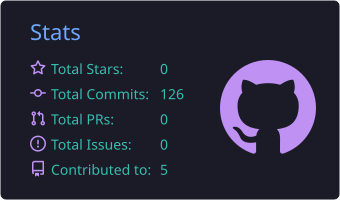
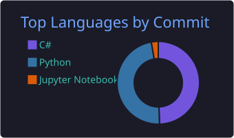

 

<h3>👨‍💻 About</h3>

I'm a Computer Engineering graduate (2026) who builds <b>practical AI/ML systems</b>: from training and comparing models to shipping LLM-powered apps that people can actually use.

<ul>
  <li>🔬 <b>Recent work:</b> compared three approaches for rice leaf disease classification (transfer learning, deep features + classical ML, handcrafted features). Deep features + SVM reached <b>89.7% accuracy</b> (5-fold CV).</li>
  <li>💼 <b>Experience:</b> internships at Kahramanmaraş Sütçü İmam University (Computer Engineering Dept.) and Refons Teknoloji.</li>
  <li>🤖 <b>Building:</b> LLM applications, prompt engineering, API integration, automation pipelines.</li>
  <li>⚙️ <b>Full-stack:</b> FastAPI + React to turn models into products.</li>
  <li>🤝 <b>Open to:</b> full-time and remote roles in AI/ML.</li>
</ul>

<h3>🛠️ Tech Stack</h3>

<h3>🚀 Featured Projects</h3>

<table>
<tr>
<td width="50%" valign="top">

<h4>🌾 <a href="https://github.com/MehmetSerdarKozz/rice-leaf-disease-classification">Rice Leaf Disease Classification</a></h4>

Three approaches compared on 10 rice leaf diseases: transfer learning, deep features + classical ML, and handcrafted features. Deep features + SVM reached <b>89.7% accuracy</b> (5-fold CV).

<code>TensorFlow</code> <code>Keras</code> <code>scikit-learn</code> <code>XGBoost</code> <code>OpenCV</code>

</td>
<td width="50%" valign="top">

<h4>📊 <a href="https://github.com/MehmetSerdarKozz/enterprise-ai-analytics">Enterprise AI Analytics</a></h4>

Multi-tenant SaaS analytics platform built solo: collects data from CSV, Excel, JSON and REST APIs, and lets users query it in natural language and ask questions about their documents with <b>RAG</b>.

<code>C#</code> <code>.NET</code> <code>TypeScript</code> <code>Python</code> <code>RAG</code> <code>LLM</code>

</td>
</tr>
</table>

<h3>📊 GitHub Stats</h3>

<!-- Kartlar .github/workflows/profile-cards.yml ile her gün bu depoda üretilir; dış servise bağlı değildir. -->

 

<h3>📫 Let's connect</h3>

